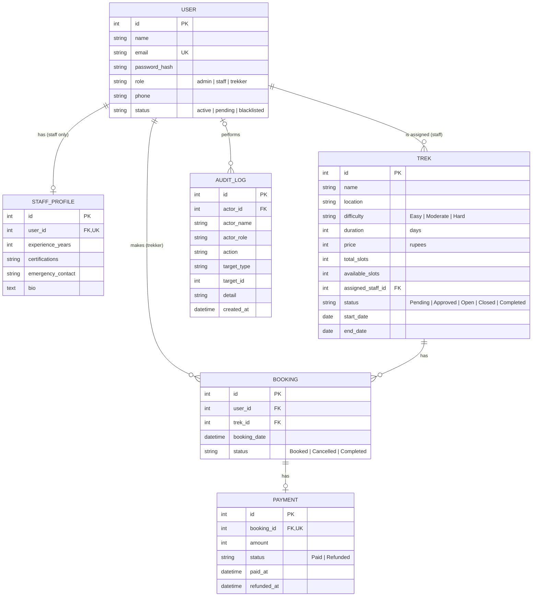

# Trekking Management System

A web app for running guided treks. Three roles share one codebase: **Admin** creates treks and manages accounts, **Trek Staff** run the treks assigned to them, and **Trekkers** browse and book. It covers a trek from creation to completion, including booking, cancellation, simulated payments and live tracking of free slots.

**Stack:** Flask, Flask-SQLAlchemy, SQLite, Flask-Login, Jinja2, Bootstrap 5.

## Background

This project started as my coursework for **Modern Application Development I** in the IIT Madras BS in Data Science program. The first commit in this repository is that original course version: three tables, three roles and a three-endpoint read-only API. Everything after it was added later, outside the course: payments, staff profiles, the audit log, the role-restricted JSON API with its OpenAPI spec, the shared rules layer and the test suite.

## What each role can do

**Admin**
- Dashboard with totals and a search box (treks, staff, trekkers by name, email or ID)
- Create, edit, delete and assign treks
- Approve, blacklist and reinstate staff; blacklist and reinstate trekkers
- See every booking with its payment state
- Activity Log of every privileged action (who, what, when)

**Trek Staff**
- Register, then wait for admin approval before the dashboard opens
- See and edit only the treks assigned to them (slots and status), and view their participants
- Keep a profile with experience, certifications, emergency contact and bio

**Trekker**
- Register and book straight away
- Browse open treks, filter by difficulty and location, see the price
- Book (one active booking per trek), cancel for a refund, see full booking history
- Edit their profile or delete their account

## Trek lifecycle

`Pending` → `Approved` → `Open` → `Closed` → `Completed`

- A new trek is **Pending**. Assigning an approved staff member moves it to **Approved**.
- Only **Open** treks can be booked, and only while slots remain.
- **Closed** stops new bookings but keeps existing ones.
- Marking a trek **Completed** also completes every active booking on it.
- Staff can set Approved, Open, Closed and Completed. Only an admin can set Pending.

## Data model

Six tables. All three roles live in one `User` table, told apart by `role`.



## API

`openapi.yaml` is an OpenAPI 3.0 description of 14 operations: 2 public and 12 role-restricted. It is checked against the real routes by the tests, so it cannot drift.

| Method | Path | Who |
|---|---|---|
| GET | `/api/treks` | public, open treks |
| GET | `/api/treks/{id}` | public, open treks only |
| GET | `/api/admin/stats` | admin |
| GET | `/api/admin/users` | admin (`?role=`, `?status=`) |
| POST | `/api/admin/treks` | admin |
| PATCH | `/api/admin/treks/{id}` | admin (fields, slots, status, staff) |
| DELETE | `/api/admin/treks/{id}` | admin |
| PATCH | `/api/admin/users/{id}/status` | admin (approve, blacklist, reinstate) |
| GET | `/api/staff/treks` | staff, own treks |
| PATCH | `/api/staff/treks/{id}` | staff, own treks (slots, status) |
| GET | `/api/staff/treks/{id}/participants` | staff, own treks |
| GET | `/api/bookings` | trekker, own bookings |
| POST | `/api/bookings` | trekker |
| PATCH | `/api/bookings/{id}/cancel` | trekker |

The API uses the same session cookie as the site. Anonymous calls get `401`, the wrong role or a pending/blacklisted account gets `403`, and booking-rule violations get `409`. All errors are JSON.

```bash
curl -c jar.txt -d "email=aditi@example.com&password=user123" http://127.0.0.1:5000/login
curl -b jar.txt http://127.0.0.1:5000/api/bookings
curl -b jar.txt -H "Content-Type: application/json" -d '{"trek_id": 2}' http://127.0.0.1:5000/api/bookings
```

## Run it

```bash
python -m venv .venv
source .venv/bin/activate          # Windows: .venv\Scripts\activate
pip install -r requirements.txt
python seed_db.py                  # creates trekking.db with demo data
python app.py                      # http://127.0.0.1:5000
```

Re-running `seed_db.py` wipes the database and restores the demo data. Set `FLASK_DEBUG=1` for auto-reload, `SECRET_KEY` for anything beyond a local demo, and `TREK_DB_PATH` to keep the database somewhere else.

## Demo accounts

| Role | Email | Password | Notes |
|---|---|---|---|
| Admin | admin@trek.com | admin123 | pre-seeded, cannot be registered or deleted |
| Staff | ravi@trek.com | staff123 | approved |
| Staff | meena@trek.com | staff123 | approved |
| Staff | karan@trek.com | staff123 | pending approval |
| Staff | suresh@trek.com | staff123 | blacklisted |
| Trekker | aditi@example.com | user123 | active |
| Trekker | rohan@example.com | user123 | active |
| Trekker | sneha@example.com | user123 | active |
| Trekker | vikram@example.com | user123 | blacklisted |

## Tests

```bash
pip install -r requirements-dev.txt
pytest
```

103 tests, run against a throwaway database. They cover access control for every API endpoint and page, booking and slot rules, the completion cascade, payments and refunds, audit logging, account deletion, and that `openapi.yaml` is valid and matches the routes.

## Design notes

- **One shared rules layer.** `services.py` holds booking, cancellation, slot resizing, status changes, staff assignment and account status. The HTML routes in `app.py` and the JSON routes in `api.py` both call it, so the two interfaces cannot disagree.
- **`available_slots` is stored, not derived.** It could be computed as `total_slots` minus active bookings. A stored count keeps every list page a plain read, at the cost of keeping it in step on book, cancel, resize and account deletion. Those paths are all in `services.py` and tested.
- **Role plus status.** `role_required` (HTML) and `api_role_required` (JSON) check the role and the account status. A pending account is held back, and a blacklisted one is logged out mid-session.
- **Ownership is in the query.** Staff routes filter on `assigned_staff_id`, so another staff member's trek is a 404, not a hidden button.
- **Payments are simulated.** A `Payment` row is recorded at booking and marked refunded on cancel. No payment gateway is involved.

## Known limitations

- Forms have no CSRF tokens. Session cookies are `SameSite=Lax`, which blocks most cross-site POSTs, but add CSRF protection before deploying anywhere public.
- Booking is check-then-write with no row locking, so two simultaneous requests for the very last slot could both pass the check.
- There are no migrations. A schema change means re-running `seed_db.py`, which resets the data.
- It runs on the Flask development server and SQLite. It is a demo, not a production deployment.

## Layout

```
app.py          HTML routes, auth, configuration
api.py          JSON API blueprint
services.py     shared business rules and audit logging
models.py       SQLAlchemy models
seed_db.py      creates and seeds the database
openapi.yaml    API description
templates/      Jinja2 templates (admin/, staff/, user/ plus shared pages)
static/css/     styles
tests/          pytest suite
```
